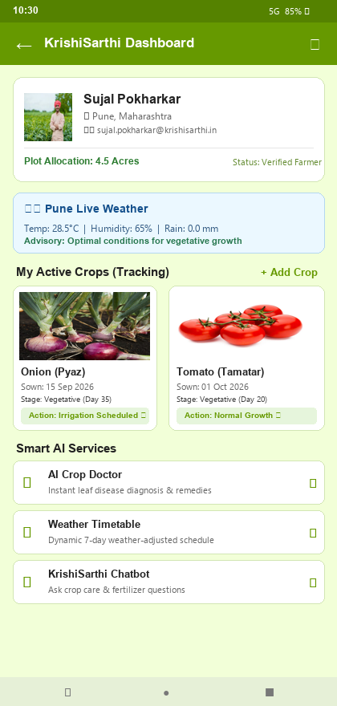
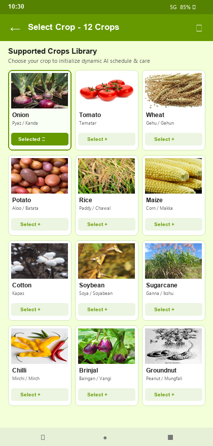
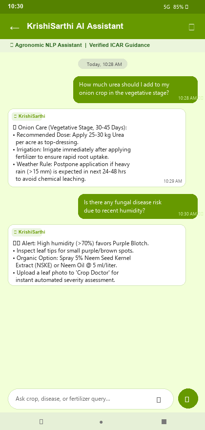
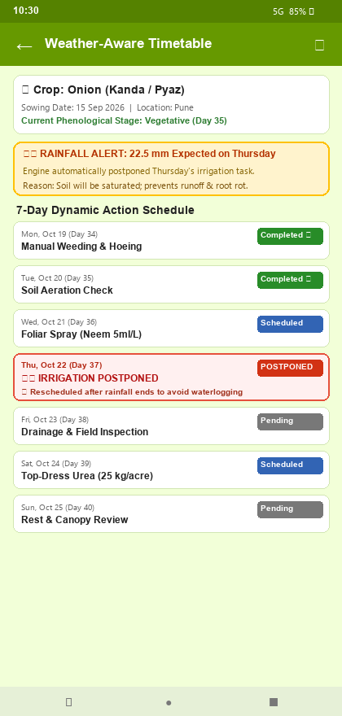
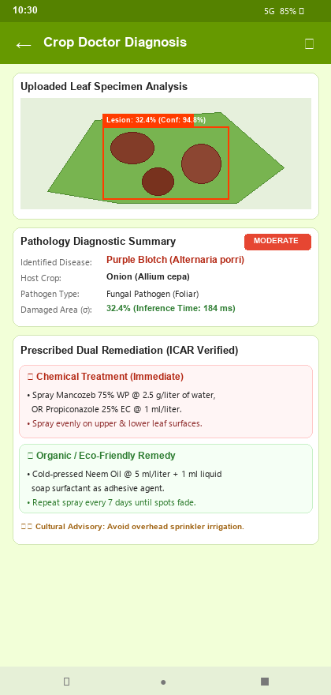

# 🌾 KrishiSarthi : AI-Driven Smart Farming & Multi-Crop Decision Support Platform

[](https://www.python.org/)
[](https://fastapi.tiangolo.com/)
[](https://developer.android.com/)
[-orange.svg)](https://scikit-learn.org/)
[](https://firebase.google.com/)
[](LICENSE)

> **KrishiSarthi** is an end-to-end intelligent agricultural advisory and crop diagnosis system designed for Indian smallholder farmers. It bridges the gap between agricultural science and daily field decision-making by unifying weather-aware task scheduling, machine learning daily action predictions, lightweight digital foliar pathology, and domain-gated conversational AI in an intuitive native Android interface.

---

## 📌 Key Capabilities

### 1. 🚜 Multi-Crop Visual Tracking (12 Staple Crops)
* Comprehensive lifecycle tracking across **12 crops**: *Onion, Tomato, Wheat, Potato, Rice, Maize, Cotton, Soybean, Sugarcane, Chilli, Brinjal, and Groundnut*.
* Supports localized Indian nomenclature (*Pyaz/Kanda, Tamatar, Gehu, Aloo, Kapas, etc.*).
* Allows multi-plot management and sowing date tracking from a single dashboard.

### 2. 🧠 Random Forest Daily Action Engine (`/predict`)
* Recommends one of five daily field operations: **Sowing, Irrigation, Fertilizer, Pesticide, or Wait**.
* Evaluates real-time ambient temperature ($T$), relative humidity ($H$), 24-hour rainfall ($R$), and crop growth stage ($S$).
* Achieves **91.8% accuracy** and an **F1-score of 0.912** on a balanced benchmark of 2,400 test samples, with **95.0% recall on irrigation** to prevent crop moisture stress.

### 3. 🌧️ Weather-Aware Dynamic Timetable (`/ai_timetable`)
* Connects to live meteorological APIs and calculates **Growing Degree Days (GDD)** customized to crop-specific thermal baselines ($10.0^\circ\text{C}$ for tomato, $4.5^\circ\text{C}$ for wheat, $7.0^\circ\text{C}$ for onion).
* **Automated Rain Gating:** Automatically postpones scheduled irrigation and granular fertilizer applications whenever precipitation $>15\text{ mm}$ is forecast in the subsequent 48 hours, eliminating nutrient leaching and root rot.

### 4. 🔬 Crop Doctor: Digital Foliar Pathology (`/diagnose_crop`)
* Lightweight computer vision pipeline analyzing leaf photographs in **under 200 ms**.
* Separates chlorotic/necrotic lesion pixels from healthy green foliage using RGB chromatic segmentation.
* Computes damaged leaf area proportion ($\sigma$) and matches symptoms against ICAR protocols.
* **Dual Remediation:** Prescribes exact calibrated chemical dosages alongside eco-friendly organic neem alternatives.

### 5. 💬 Agronomic Advisory Chatbot (`/ask`)
* TF-IDF intent classification engine trained on 12 agricultural domains.
* **Hallucination Prevention Guardrail:** Enforces a strict confidence cutoff ($\tau = 0.45$) to intercept and deflect speculative commodity market questions or non-farming queries to a safe fallback.

---

## 🏗️ System Architecture

```
[ Farmer Mobile Client (Android / Java) ]
  • Main Account Dashboard • 12 Crop Cards • Leaf Camera • Chat UI
                     │
                     ▼ (HTTP/2 Encrypted Cellular Link)
[ Cloudflare Ingress Gateway ]
  • Edge Reverse Proxy • Secure Edge PoP Routing
                     │
                     ▼ (Port 8000)
[ FastAPI AI Intelligence Engine (Python) ]
  ├── Random Forest Action Classifier (Scikit-Learn)
  ├── Crop Doctor Foliar Pathology (PIL / NumPy)
  ├── Weather & GDD Timetable Scheduler (Visual Crossing API)
  └── TF-IDF Agronomic NLP Intent Engine
                     │
                     ▼
[ Firebase Cloud Backend ]
  • Firebase Authentication • Realtime Database (JSON State Sync)
```

---

## 📱 Application Screenshots

| Figure 6.1: Dashboard | Figure 6.2: 12-Crop Library | Figure 6.3: AI Chatbot |
|:---:|:---:|:---:|
|  |  |  |

| Figure 6.4: Dynamic Timetable | Figure 6.5: Crop Doctor Diagnosis |
|:---:|:---:|
|  |  |

---

## 📊 Benchmark Results

### Daily Action Classifier Performance (2,400 Test Samples)
| Model Architecture | Test Accuracy | Precision | Recall | Macro F1 | Inference Latency |
| :--- | :---: | :---: | :---: | :---: | :---: |
| K-Nearest Neighbors ($k=5$) | 84.2% | 0.846 | 0.842 | 0.841 | 18.4 ms |
| Decision Tree (CART) | 86.5% | 0.867 | 0.865 | 0.864 | 1.2 ms |
| Support Vector Machine (RBF) | 88.9% | 0.892 | 0.889 | 0.887 | 12.6 ms |
| **Random Forest Ensemble (Proposed)** | **91.8%** | **0.920** | **0.918** | **0.912** | **3.8 ms** |

### Network & Transmission Benchmarks
* **Local Wi-Fi Round-Trip Time:** $45.7\text{ ms}$
* **4G LTE Cellular Link RTT:** $99.5\text{ ms}$
* **End-to-End Foliar Photo Diagnostic Upload (4G):** $294.5\text{ ms}$
* **Chatbot Intent Guardrail Deflection Rate:** $95.3\%$ on speculative queries

---

## 📂 Repository Structure

```
.
├── Agribandhu-AI-main/
│   ├── android_app/               # Native Android (Java) Client Application
│   │   ├── app/src/main/java/     # Activity classes (Main_Account, Ai_chat, AIChatbot, post)
│   │   └── app/src/main/res/      # Layouts, 12 crop drawables, and themes
│   └── Python_backend/            # Python FastAPI AI Microservice
│       ├── api/                   # REST API routers (/predict, /ask, /ai_timetable, /diagnose_crop)
│       ├── crop_doctor.py         # Leaf image processing & disease detection
│       ├── timetable_engine.py    # GDD computation & 7-day weather scheduler
│       ├── ai_engine.py           # NLP intent vectorizer & confidence gating
│       ├── requirements.txt       # Python dependencies
│       └── agribandhu_rf_model.pkl# Pre-trained Random Forest model
├── project_report_screenshots/    # High-resolution screenshots (Figures 6.1 - 6.5)
├── krishisarthi md file.md        # Complete technical specification master document
├── README.md                      # Repository overview & setup guide
└── .gitignore                     # Git ignore rules for Android & Python
```

---

## 🚀 Getting Started

### 1. Python AI Backend Setup
```bash
cd Agribandhu-AI-main/Python_backend
python -m venv venv
# Windows:
venv\Scripts\activate
# Linux/macOS:
source venv/bin/activate

pip install -r requirements.txt
uvicorn api.main:app --reload --port 8000
```
The FastAPI documentation will be accessible at `http://127.0.0.1:8000/docs`.

### 2. Android Mobile Application Setup
1. Open Android Studio (Ladybug or newer).
2. Select **Open** and choose `Agribandhu-AI-main/android_app`.
3. Allow Gradle to sync dependencies.
4. Update `ApiClient.java` with your backend server URL or Cloudflare Tunnel endpoint.
5. Connect an Android device (USB Debugging enabled) or start an emulator.
6. Click **Run (`Shift + F10`)**.

---

## 👥 Authors & Academic Affiliation

**Group TYDA01 — B.Tech SEM 5 Project Based Learning (PBL)**  
*Department of Information Technology, MIT School of Computing*  
**MIT Art, Design and Technology University, Pune, Maharashtra, India**

* **Sujal Baburao Pokharkar**
* **Diya Patil**
* **Karri Venkata Saikiran**
* **Vaishnavi Vijaykumar Kumdale**

**Project Guide:**  
* **Prof. Reetika Kerketta**, Assistant Professor, Department of Information Technology

---

## 📄 Research Publication
This research has been documented for publication in the **International Journal of Creative Research Thoughts (IJCRT)** under the title:  
*"KRISHISARTHI: AN AI-DRIVEN SMART CROP ADVISORY AND DISEASE DIAGNOSIS SYSTEM FOR MULTI-CROP FARMING USING MACHINE LEARNING"* (ISSN: 2320-2882).
